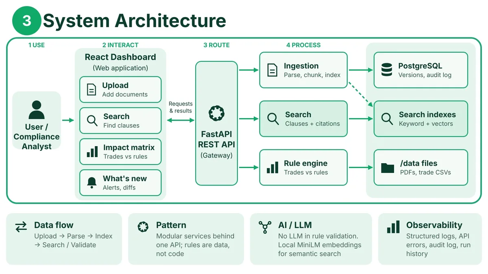
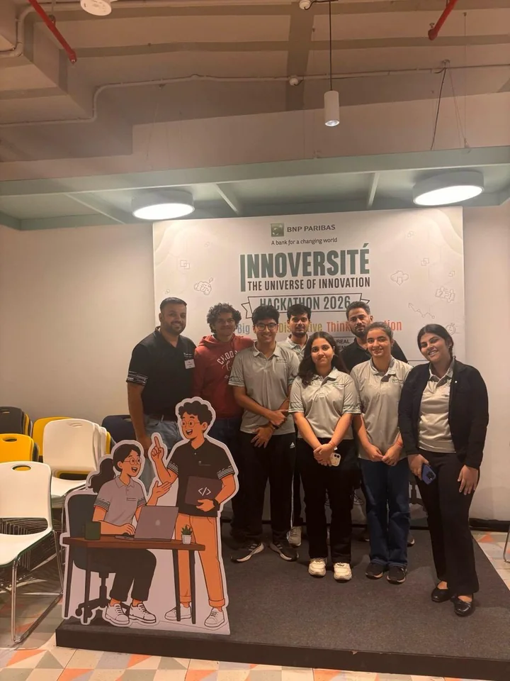
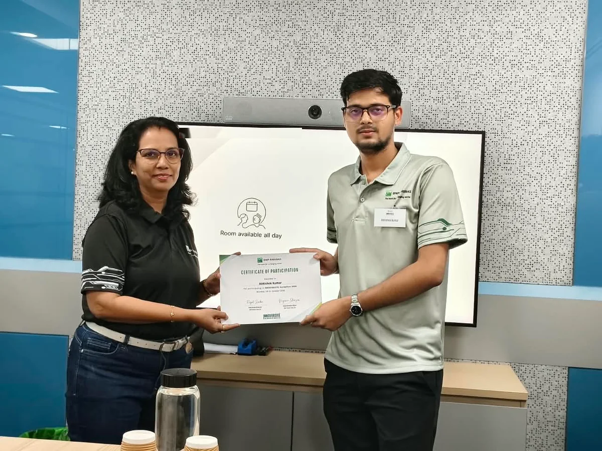

We thought we were done.

Then Dharmesh Mehta, who owned our use case, pushed us to align our solution more closely with the actual problem.

So we didn't sleep. We spent the night reworking it, and by morning the solution was much stronger than the one we had called finished.

## The event

Innoversité 2026 was a 24-hour hackathon at BNP Paribas's Mumbai office, on 10–11 October 2026. I was in Team 35, with five teammates.

One rule stood out. AI tools with file or shell access were banned. No Copilot, no Cursor, no Claude Code. We could use web chat UIs, but only by copying and pasting. More on that later.

## The problem, in plain words

Banks have to follow regulations like MiFID II, EMIR and the FCA's rules. These documents are long, they change, and compliance teams have to find what a rule actually says and then check whether real trades break it.

Doing that by hand is slow, and it is hard to show later how you reached a conclusion. Our job was to build a tool that helps with both parts: finding the rules, and checking trades against them.

## What we built

We called it Reg IRIS, short for Intelligent Regulatory Repository & Impact Scanner.

It does four main things:

- **Upload** regulatory documents.
- **Search** them two ways: Elasticsearch for keyword search, and an offline semantic search using Chroma with MiniLM embeddings.
- **Version** documents, so a re-upload doesn't silently replace the old copy.
- **Run an Impact Matrix**, which checks a CSV of trades against MiFID II, EMIR and FCA rules and shows which trades fail.



The stack was FastAPI and SQLAlchemy 2.0 on PostgreSQL for the backend, React with Vite for the frontend, and Docker Compose with nginx to run it all together.

My own work had two parts: the rule engine, which I'll come to next, and integrating the team's frontend and backend. After merges, some API paths were wrong and some models and imports conflicted, so I fixed those.

I added guardrails to uploads: corrupt or encrypted PDFs, non-UTF-8 files, and limits on file size and type. I redesigned document versioning so every re-upload creates a new version, labelled by its byte hash.

I also built the Impact Matrix table from the backend's own export CSV. That way, the screen and the download always match.

We packaged it with the CPU-only build of PyTorch. That avoided about 3 GB of CUDA libraries we didn't need. We didn't deploy it anywhere, though. We ran out of time.

## My part: the rule engine

The main design choice in the rule engine was this: the engine has zero regulation-specific code. Every rule lives in a JSON file, written in JSONLogic. The engine only knows how to read JSONLogic, not what MiFID II or EMIR say.

That matters for a compliance tool. If someone wants to check that nothing is hard-coded, they don't have to trust us. They can read the rule files.

I wrote the JSONLogic interpreter by hand. Here's a made-up example of the kind of rule it runs. It is not from the hackathon dataset:

```json
{
  "and": [
    { ">": [{ "var": "quantity" }, 0] },
    { "in": [{ "var": "currency" }, ["EUR", "GBP", "USD"]] }
  ]
}
```

In plain words: a trade passes only if its quantity is above zero and its currency is one of three allowed values. The interpreter walks this tree for each trade, looks up `quantity` and `currency` in the row, and works out true or false.

Around the interpreter, I built four pieces:

- **A loader** that reads the rule files, versions each one with a SHA-256 hash, and hot-reloads them, so a changed rule is picked up without restarting the server.
- **A CSV schema validator** that catches malformed rows.
- **An evaluator** that explains why each trade failed, not just that it failed.
- **An export** that writes a Pass/Fail result for each regulator as a CSV.

Before running any tests, I built my own test CSVs and wrote down how many violations each one should produce. Then I ran them. The results matched my predictions: 18 out of 18, and later 9 out of 9.

By the end we had 96 unit tests, with 90 passing. The six failures were integration tests waiting on a reference dataset we didn't have yet.

## The rules were broken

We were given eight rules to implement. Three of the eight supplied rules were logically broken.

When I ran all eight rules on the sample trades, five matched the counts I expected but three flagged far more trades than made sense, and one flagged every single trade.

Two were missing a scope condition, so a check meant for one kind of trade was applied to all of them. The third compared a date as if it were a number, so it could never pass.

We had two bad options. Silently fix the rules, and the tool no longer matches what we were given. Keep them as they are, and the tool reports violations that aren't real.

So we did both. We kept the original rules untouched, for auditability, and added a toggle to switch to a corrected set. Switching to the corrected set cut the number of violations sharply.

For a compliance tool, I think that is the right trade-off. You can always see what was supplied, what we changed, and how much it changed the result.

## Building without agentic AI tools

We could use web-based AI chat (Claude for architecture and backend, Gemini for long-document research) but nothing that touched the code directly, so every line went in by copy-paste after we had read it.

I led the team, split the work into lanes, and helped my teammates with their parts alongside building the rule engine.

## The mentors

Dharmesh Mehta owned our use case, and he is the reason for that all-nighter. When we thought we were finished, he pushed us to match the solution more closely to the problem. It cost us a night's sleep and made the solution much stronger.

Mentor feedback also changed the product. We added per-run rule selection, so you can choose which rules to check in each run. We added document versioning on re-upload. And semantic search went from a nice extra to a required feature.

Nishit Naik and Vishal Sharma also mentored us.



Nirmal Goswami was one of the evaluators. In the tense moments, he kept us calm. He also took me aside for a one-on-one talk. He asked about my interests, family and hobbies, and what I want to learn next.

## What I learned

**Supplied data can be wrong.** The rules came with the problem, and three of the eight were still broken. Check inputs before trusting them, and when you fix something, keep the original next to the fix.

**Predict the result before you run the test.** Writing down the expected violation count first meant a passing test actually told me something. A number I hadn't predicted would have been just a number.

**Keep the domain logic in data.** Because the rules were JSON, fixing a broken rule meant editing a file, not the engine. It also meant anyone could check our claim that nothing was hard-coded.

**"Done" is decided by the problem, not by us.** We had a working app. It was not yet the right app. The extra night we spent getting closer to the actual problem is what made the solution much stronger.

## What came next

I was selected for a six-month internship at BNP Paribas, starting in January 2027.


